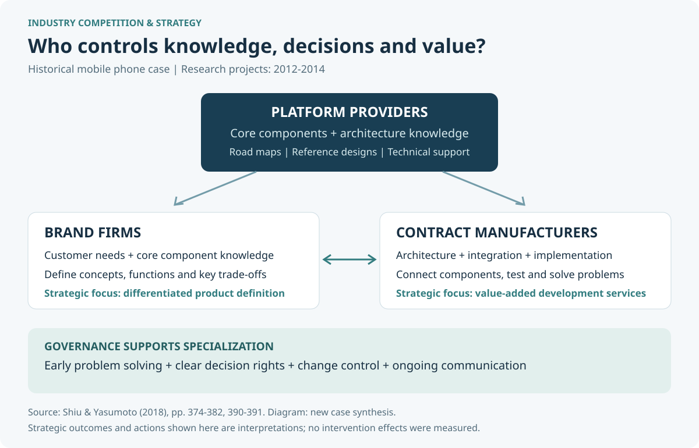
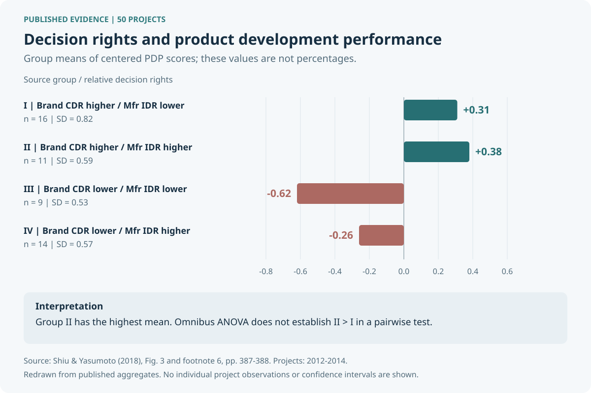

# 行動電話產業競爭與策略分析

### 平台知識、企業分工與競爭優勢

[English](README.en.md) · [完整案例報告](docs/industry-strategy.zh-TW.md) · [策略方案](docs/strategy-playbook.zh-TW.md) · [研究證據與限制](docs/evidence-review.md)

**當核心技術掌握在平台提供者手中，手機品牌商與代工廠如何建立自己的競爭優勢？**

本專案將產業競爭分析課程的 Group H 小組報告，整理為以行動電話產業為背景的策略案例。從品牌商、台灣合約製造商與平台提供者的三方關係出發，分析知識如何改變企業邊界、議價位置與產品開發決策權，再提出對應的能力建構與合作治理方案。

> **案例主張：** 品牌商需要具備把市場需求轉成產品概念的能力，代工廠需要發展把概念落實成產品的架構整合能力；雙方透過早期協作與持續溝通，才能降低分工帶來的摩擦。這是依歷史研究形成的策略解讀，適用條件仍需逐案檢驗。



## 這份分析回答什麼問題

| 分析問題 | 主要判斷 | 內容 |
|---|---|---|
| 產業中的競爭不只發生在手機品牌之間，還發生在哪裡？ | 平台掌握關鍵知識與技術支援；品牌商和代工廠也競爭價值鏈中的主導權 | [產業結構與競爭壓力](docs/industry-strategy.zh-TW.md#2-產業結構與競爭壓力) |
| 企業應該自己做什麼、交給夥伴做什麼？ | 比較相對知識優勢，分別設計概念與實施決策權，避免把外包等同於放棄能力 | [分工模式與策略取捨](docs/industry-strategy.zh-TW.md#3-分工模式與策略取捨) |
| 品牌商與代工廠如何避免落入價格競爭？ | 品牌商深化產品定義；代工廠以整合、測試與問題解決能力增加價值 | [三方策略選擇](docs/strategy-playbook.zh-TW.md) |
| 模組化產品為何仍需密切協作？ | 決策權可能帶來自利行為與投入不足，需搭配資訊、誘因與升級處理機制 | [合作治理](docs/industry-strategy.zh-TW.md#5-合作治理也是競爭策略的一部分) |

## 研究依據與關鍵證據

主要依據為 Shiu 與 Yasumoto（2018）的研究書章，以及小組對該研究的報告。原研究以 **2012–2014 年、8 家台灣合約製造商的 50 個智慧型手機開發專案**為樣本；2015 年取得問卷。這些是作者研究的資料，並非本專案自行蒐集的資料。[研究來源與定位](docs/sources.md)



原研究中，品牌商概念決策權與代工廠實施決策權皆較高的組別，平均產品開發績效為 **0.38**，是四組最高的描述值。但另一組為 **0.31**；整體 ANOVA 的差異不能直接當作這兩組之間顯著不同的證明。績效數值經中心化，**不是報酬率、百分比或市占率**。完整解讀見[證據審閱](docs/evidence-review.md)。

## 分析方法與成果

- **產業競爭：** 以價值鏈、五力問題與平台依賴，辨識不同層次的競爭壓力。
- **企業策略：** 以相對知識優勢、能力建構與企業邊界，分析品牌商與代工廠的策略取捨。
- **合作治理：** 將決策權、早期問題解決、變更管理與溝通機制連結到策略執行。
- **研究判讀：** 核對研究設計、樣本範圍、統計摘要與推論限制。

本次整理新增的五力映射、策略方案及衡量指標均標示為**案例延伸分析**，不是原研究直接測量或已實施的成果。專案不提供當前市場排名、市占率或投資建議。

## 閱讀路線

1. [完整產業與策略報告](docs/industry-strategy.zh-TW.md)：問題、產業結構、分工選擇、研究判讀、治理與結論。
2. [策略方案與執行設計](docs/strategy-playbook.zh-TW.md)：品牌商、代工廠與平台提供者各自的行動、取捨及驗證指標。
3. [研究證據審閱](docs/evidence-review.md)：四組摘要、迴歸係數、原文差異與不能支持的主張。
4. [來源與頁碼對照](docs/sources.md)：四份來源的性質與引用位置。
5. [小組與個人貢獻](docs/contribution.md)：小組成果、本人參與範圍及本次整理的區分。

## 資料與圖表核對

公開的 [published-summary.json](data/published-summary.json) 僅轉錄已發表的彙總數值，沒有逐筆專案資料。使用 Python 3 標準函式庫即可核對樣本合計、摘要數值、檔案連結與重繪圖表：

```bash
python3 scripts/verify_case_study.py
python3 scripts/build_figures.py --check
```

這些檢查核對公開整理的一致性，**不會重跑原始迴歸，也不會驗證研究的因果關係**。

## 來源與成果歸屬

本人共同參與 Group H 整份報告製作。原學術研究歸 Shiu 與 Yasumoto 所有，原課程報告為小組共同成果；本專案另行整理產業競爭與策略分析。完整書章、機器翻譯與含第三方素材的原始投影片保留於本機，公開版本提供重寫分析、來源頁碼及彙總資料。[貢獻說明](docs/contribution.md) · [使用與歸屬聲明](NOTICE.md)
